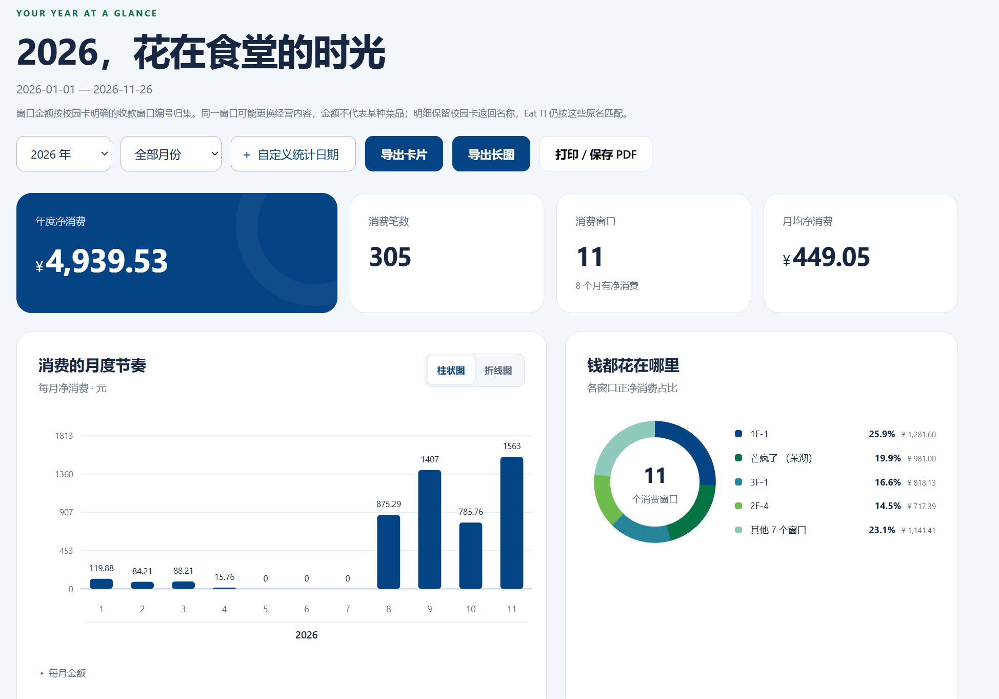
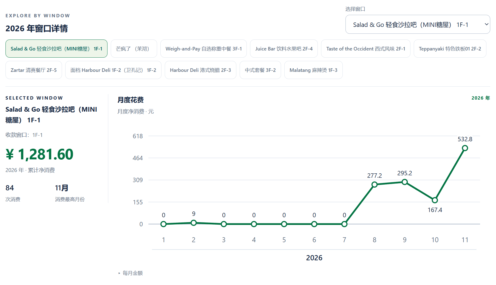
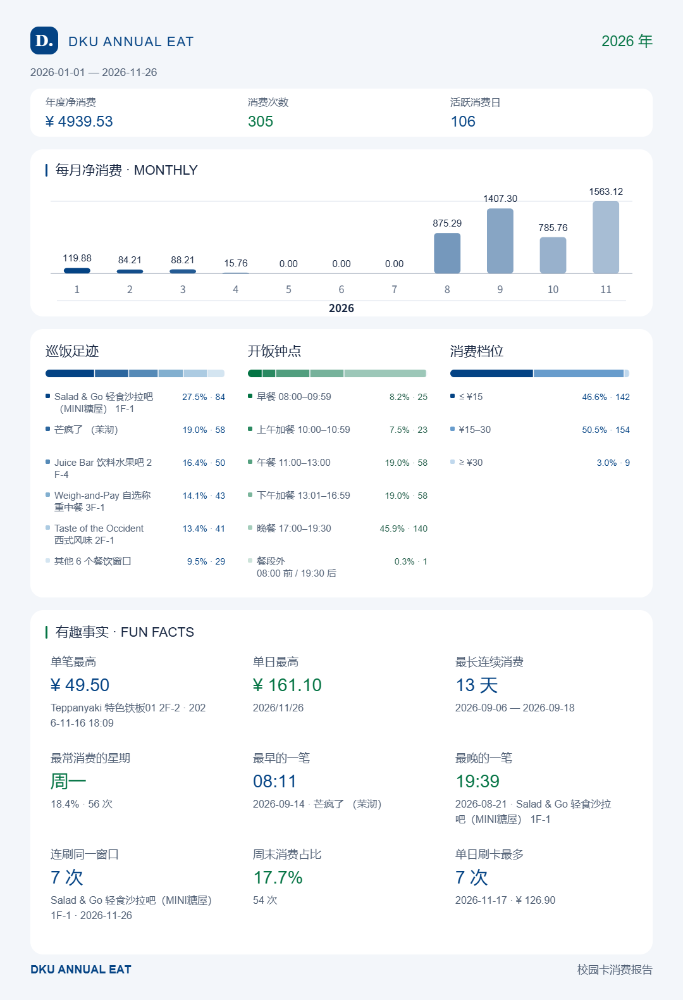
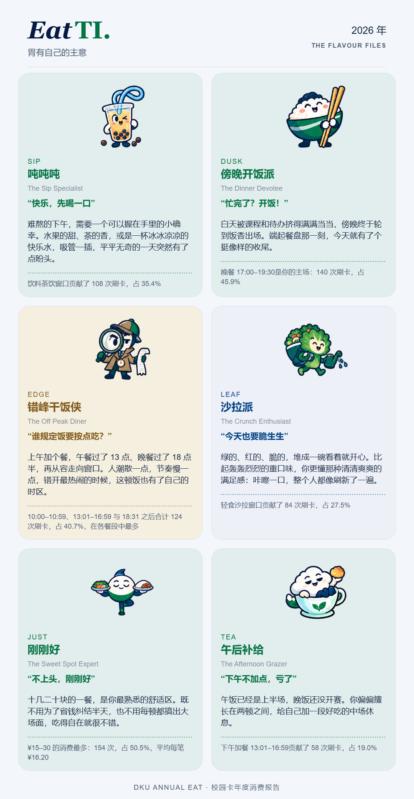

# DKU Annual Eat

[Chinese](README.md#language-chinese) · [English](#language-english)

DKU Annual Eat turns Duke Kunshan University campus card transactions into an annual report. Choose a year, month or custom date range to explore spending, counter rankings and dining habits, or open the Eat TI dining characters. Reports can be exported as cards, long images or printable documents. Records stay on your computer and are not uploaded to a project server.

[Download v1.4.0](https://github.com/guyong1449/DKU-Annual-Eat/releases/tag/v1.4.0).

## Report previews

<table>
  <tr>
    <td width="50%" valign="top">
      

      

      
    </td>
    <td width="50%" valign="top">
      

      
    </td>
  </tr>
</table>

## Install the browser extension (recommended)

Download the [browser extension package](https://github.com/guyong1449/DKU-Annual-Eat/releases/download/v1.4.0/DKU-Annual-Eat-1.4.0-extension.zip) and extract the entire archive into a folder you plan to keep. Do not open files directly inside the archive. Find `manifest.json` in the extracted files. If there is an outer folder, open it until you reach the folder containing that file.

In Google Chrome, enter `chrome://extensions` in the address bar. In Microsoft Edge, enter `edge://extensions`. Enable Developer mode, select Load unpacked, and choose the folder containing `manifest.json`. Select the extracted folder, not the archive. This release is installed manually and is not listed in an extension store.

Open the browser's extensions menu, find DKU Annual Eat, and pin it or choose to show it in the toolbar. Click its icon to open the tool, select a date range, and click Collect new data. Complete the school single sign-on and multi-factor authentication in the school page that opens. The extension will then continue collecting records. Keep the campus card tab open without refreshing it. You can close the tool page and click the extension icon later to view the result.

At the top of a report, switch between the annual spending report and the Eat TI dining characters. Use the report controls to change dates or export images. Offline page and original data exports are at the bottom of the page. To reuse data from the local application, select Import old JSON in the report library and choose your exported `.json` file.

## Use the local application

If you prefer a launcher, download the [Windows package](https://github.com/guyong1449/DKU-Annual-Eat/releases/download/v1.4.0/DKU-Annual-Eat-1.4.0-win-x64.zip), [Apple silicon package](https://github.com/guyong1449/DKU-Annual-Eat/releases/download/v1.4.0/DKU-Annual-Eat-1.4.0-mac-arm64.zip) or [Intel package](https://github.com/guyong1449/DKU-Annual-Eat/releases/download/v1.4.0/DKU-Annual-Eat-1.4.0-mac-x64.zip). Extract the whole archive, then double-click the `.cmd` launcher on Windows or the `.command` launcher on a Mac. Choose dates in the tool and sign in on the school page when prompted. The runtime is included; no separate Node.js installation is needed.

### First-launch permissions for the macOS script

Apple computers require macOS 13.5 or later. Both Mac packages include a quick-start guide, a first-launch permissions guide and a screenshot of the security settings. Read them after extraction, or [view the permission illustration](https://github.com/guyong1449/DKU-Annual-Eat/blob/main/docs/macos/%E5%AE%89%E5%85%A8%E6%80%A7%E8%AE%BE%E7%BD%AE%E6%96%B9%E6%B3%95.png) before downloading.

Double-click the `.command` launcher once. If macOS blocks it or cannot verify the developer, open System Settings → Privacy & Security, find the blocked file in the Security section and click Open Anyway. Confirm the next prompt, complete any authentication requested and open the launcher again. If `node` is blocked separately, repeat the approval for that file. The illustration's example app name represents one of these files. See the [Apple instructions](https://support.apple.com/102445) for the process.

For Safari collection, enable web developer features in Safari → Settings → Advanced, then turn on Allow JavaScript from Apple Events in Developer settings or the Develop menu. Start collection and allow the launching application, usually Terminal, to control Safari when prompted. If you declined before, enable the application's Safari permission in System Settings → Privacy & Security → Automation, then retry. Complete school sign-in and multi-factor authentication in the new Safari window and keep its original single tab open during collection. These Safari settings are not needed for Chrome or Edge.

## Update and keep your data

Before updating the extension, export the original data as a backup. Replace the files in the same installation folder and click Reload on the extension management page. Keep that folder; uninstalling the extension, clearing its data or switching browsers requires importing your backup again. For the local application, copy the old `private/` folder into the new version to keep your records.

Counter names use the full names returned by the campus card system, while totals group explicit counter codes. Menus and operators can change, so historical totals cannot identify spending on a particular dish. Eat TI keeps its original records and rules.

The project idea draws on [SJTU Annual Eat](https://github.com/Milvoid/SJTU-Annual-Eat), with colors inspired by [DKU Beamer](https://github.com/EricZQu/DKU-beamer-presentation) and [DKU Note](https://github.com/EricZQu/DKU-Note-Template). The code is released under the [MIT License](LICENSE).
